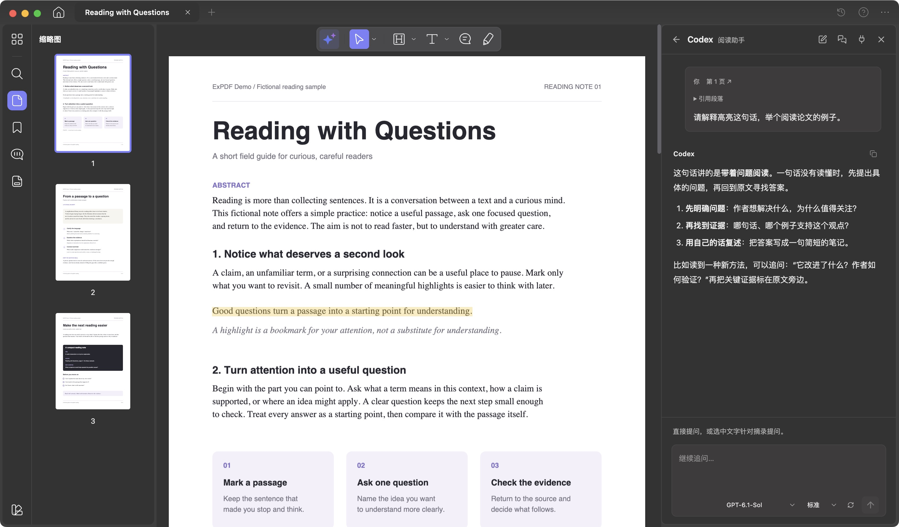

# ExPDF

**English** | [简体中文](README.zh-CN.md)

A lightweight PDF reader that works with your existing Codex subscription.

Read, annotate, and ask Codex about a PDF in one window. ExPDF uses the sign-in and subscription from your local Codex CLI. Select a passage for an explanation, translation, or summary, or ask a question and find related content in the document.

[Download for macOS](https://github.com/2020-qqtcg/ExPDF/releases/download/v1.0.0/ExPDF-1.0.0-arm64.dmg) · [v1.0.0 Release](https://github.com/2020-qqtcg/ExPDF/releases/tag/v1.0.0) · [Changelog](CHANGELOG.md)



The PDF and conversation shown here are demo content.

## Read with Codex

Click the AI button in the reading toolbar to ask a question. You can also select text and choose **Ask Codex** from the floating toolbar to discuss a specific passage.

- Explain passages, translate, summarize key points, and ask follow-up questions about the current page.
- Search the document, read related pages, jump to the source, or ask the assistant to add highlights and notes.
- Start separate conversations for the same PDF and return to previous chats.
- Choose a model and reasoning effort at the bottom of the input box. Drag the sidebar edge to adjust its width.
- Read tables, equations, and code in answers, copy code, or open generated documents.

The assistant can also use tools configured in your local Codex for web research, terminal calculations, and file processing. Activity, approval requests, and follow-up questions appear in the sidebar.

## Reading and annotation

- **Multiple PDFs**: Open or drop in several files and switch between tabs. Each document keeps its own reading position, zoom, search, and chat draft as you switch. Reopen the app to continue reading.
- **Navigation**: Find content through thumbnails, the table of contents, page numbers, full-text search, and bookmarks. Read continuously, fit pages to width, rotate them, or pan around the page.
- **Markup**: Select text to highlight, underline, strike through, or add a squiggly underline. Add notes or draw freehand. Annotations can be edited, moved, deleted, undone, and redone.
- **Text annotations**: Click a page to add text. Adjust the font, size, color, bold, italic, alignment, and line spacing using local or imported fonts.

Reading progress and annotations are saved locally as you work. **Save** writes annotations to the current PDF; **Save As** creates a new file. Reopen earlier documents from **Recent Documents**.

Pages fit the available width by default and adjust when you resize the window or open a sidebar. You can also zoom with a trackpad pinch or Ctrl + mouse wheel.

## Install

For **macOS 13 or later on Apple silicon (arm64)**.

1. Download and open `ExPDF-1.0.0-arm64.dmg`.
2. Drag `ExPDF.app` into Applications.
3. Launch ExPDF and open or drop in a PDF.

To use the AI assistant, follow the [Codex CLI installation guide](https://learn.chatgpt.com/docs/codex/cli), then sign in with your ChatGPT account:

```bash
codex login
```

ExPDF uses your existing local Codex sign-in and subscription without a separate API key in the app. If you are already signed in to Codex, you can start asking questions right away.

## Run from source

Requires **Node.js 22.13+**. Node.js 24 LTS is recommended.

```bash
git clone https://github.com/2020-qqtcg/ExPDF.git
cd ExPDF
npm ci
npm run desktop
```

Build the macOS Apple silicon installer:

```bash
npm run package:mac
```

The installer is written to `release/1.0.0/ExPDF-1.0.0-arm64.dmg`, and the app is in `release/1.0.0/mac-arm64/ExPDF.app`.

Develop or preview in a browser:

```bash
npm run dev
# Production build and preview
npm run build
npm run preview
```

Open the local URL shown in the terminal.

## Keyboard shortcuts

| Action | Shortcut |
| --- | --- |
| Open PDF | ⌘/Ctrl + O |
| Search document | ⌘/Ctrl + F |
| Save / Save As | ⌘/Ctrl + S / ⌘/Ctrl + Shift + S |
| Close current tab | ⌘/Ctrl + W |
| Next / previous tab | Ctrl + Tab / Ctrl + Shift + Tab |
| Undo / redo | ⌘/Ctrl + Z / ⌘/Ctrl + Shift + Z |
| Select text / pan | V / H |
| Finish a note or text annotation | ⌘/Ctrl + Enter |
| Send question / new line | Enter / Shift + Enter |
| Cancel editing | Escape |
